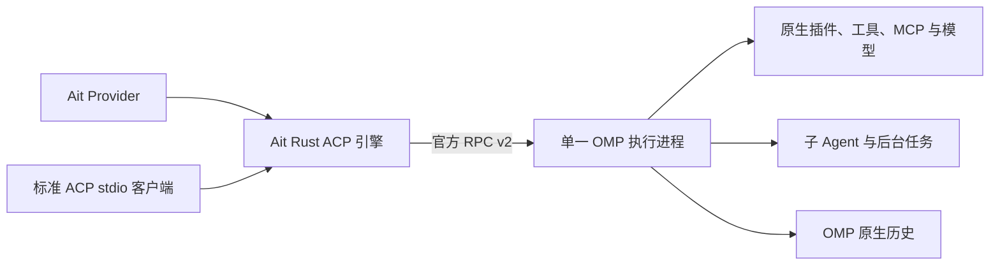

# OMP ACP 桥接与插件兼容

Ait 负责适配官方 OMP，不要求 OMP 配套修改。决策见
[ADR-190](../decisions/providers/adr-190-omp-acp-settlement.md)。
遗漏终态时的原生状态核对与取消期限见 [ADR-194](../decisions/providers/adr-194-omp-settlement-reconciliation.md)。

每个连接拥有一个正式原生会话。内嵌客户端直接调用同一协议引擎，
外部客户端通过 `daemon omp-acp` 读写有界 JSONL。
两条入口都执行 ACP 请求转换；原生对话提交也是 RPC，不是直连 OMP 自带 ACP。
模型、推理和特性开关使用原生 RPC 原地更新，保留同一个插件进程。
只有 CLI 绑定的权限模式/系统提示变化才按原有规则重开，已落盘历史使用原生 resume。
空原生会话重开可能更换 native ID；独立 ACP 连接的 ID 由 Ait 自己的别名记录保持稳定，
不会因此丢失 load/resume。记录在原生 sessions 同级 `ait-acp-aliases/`，每条限 1 MiB，
包含会话句柄、cwd 和配置，不含认证；原子替换、限制私有目录权限，并拒绝符号链接和跨 cwd 恢复。
目录/服务档位探测使用独立 `--no-session` 实例，其状态不代表正式会话。

## 能力映射

| 能力                   | 路由与所有权                                                                                                                    |
| ---------------------- | ------------------------------------------------------------------------------------------------------------------------------- |
| 模型、推理             | 原生 RPC 动态目录和 available levels → ACP select options；模型使用 `[provider, modelId]` JSON 字符串，不按插件或模型名推断能力 |
| 权限模式               | ACP mode/select → 官方 approval-mode；保留 Full/Write/Ask/Ask and Remember 及未覆盖时的原生配置                                 |
| 压缩、重试、fast/slow  | ACP select 的字符串 `true/false` → 对应官方 RPC；由当前模型及 OMP 验证，不向官方 ACP 发送自造 boolean options                   |
| 系统提示               | Ait 配置元数据 → 官方 CLI；重开时恢复同一份已持久历史，不重发输入                                                               |
| 文本、推理、工具与图片 | 标准 ACP 通知；Ait 内嵌客户端使用协商的完整宿主事件，保留原有身份、富输入和图片工件                                             |
| token/cost、上下文     | 原生用量投影 → Ait 事件；标准 ACP 使用 usage updates，额外原生字段保留在协商通道                                                |
| 命令、技能、插件工具   | OMP 动态发现/执行；Ait 不按插件名称、命令名称或安装路径添加分支                                                                 |
| 审批和插件问答         | 标准 permission/form，支持选择、输入、确认、编辑和结构化 ask；Ait 保留原生授权与多选语义                                        |
| 自定义消息             | 可见 `custom`/JSONL `custom_message` 共用投影；保留 customType，隐藏上下文不展示；command_output/notify 作为临时输出显示        |
| 后台工作               | 原生 `prompt_result` + `session_settled`，遗漏时以同一进程的明确 `get_state.isSettled` 核对；不以无输出或 agent_end 合成完成    |
| 子 Agent               | 原生会话自己的订阅、状态、进度和消息；Ait 子 Agent 时间线通过完整宿主事件保留                                                   |
| 取消、steering         | ACP 方法 → 当前原生回合；控制响应与交互回调分别关联                                                                             |
| 历史和恢复             | 只读 OMP JSONL，保留当前分支、session ID、回执和 blob；ACP load 回放，resume 继续执行                                           |
| 本机 MCP 和插件配置    | 由同一个原生 RPC 实例按官方规则加载；客户端的空 server 列表不会清掉本机 MCP                                                     |

## 通用原生扩展通道

客户端在 initialize 的 `clientCapabilities._meta` 中设置 `ompNative: true`，
桥接层以 `_meta.ompNative.version: 1` 宣告支持；这不是 OMP 的扩展要求。

- `_omp/rpc`：`{sessionId, command, arguments}`，异步关联官方原生控制请求及结果。
- `_omp/event`：`{sessionId, frame}`，传递原生事件、扩展 UI 和 callback，保留未知字段。
- `_omp/respond`：`{sessionId, frame}`，将原生 UI/tool/URI 回应交还同一实例；检查 callback 身份和种类。

控制期间继续交付交互请求；不会因先等待命令确认而卡住插件。
改变会话/回合所有权的原生命令不能绕过 ACP 生命周期路由，未知原生控制由 OMP 自己拒绝。
错误字段沿用有界脱敏，普通插件数据不按插件名称改写。

内嵌 Ait 客户端还协商 `_meta.ait: 1`，收发 `_ait/event` 及 prompt result metadata，
从而保留原有 Timeline、图片、用量、子 Agent、持久句柄和失败事件。
普通 ACP 客户端不需要理解这些 Ait 事件。

## 实际边界

原生 RPC 物理输入/输出帧限 1 MiB，v2 输出可重组至 64 MiB；
桥接 JSONL、原生单个历史文件限 64 MiB，模型目录限 8192 项。
超过预算明确失败，不截断协议或重放输入。

官方 RPC 不导出任意 TUI 组件工厂、主题、footer/header 或编辑器组件。
这些内容无法仅凭协议远程复现；原生 notify/status/widget/editor 等已有帧则可以通过协商通道传递。
Ait 当前界面仍以工具、问答和自定义消息展示为主，不能把通道透传等同于已实现所有 TUI 布局。

OMP 会延迟持久化没有 assistant 消息的原生会话；仅插件本地输出不保证已经产生 JSONL。
Ait 不伪造原生落盘成功。验证使用用户授权的实际模型产生 assistant/tool 记录，再核对真实历史恢复。
OMP 可能用自身通用 deferred-tool 路由执行插件工具；桥接层保留原生名称与参数，不猜测或改写插件身份。
当前不增加原先未提供的每会话 MCP 覆盖、宿主工具自动注册、文件回退或输出 schema。

[官方版本、定向检查及插件验证](../reports/providers/omp-acp-settlement-2026-10-25.md)。
