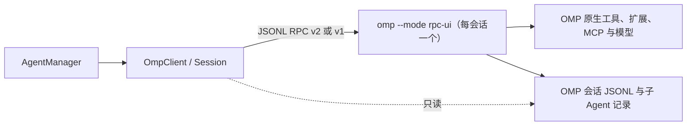

# Oh My Pi 现行规格

本页列出 `crates/provider-omp` 当前生效的行为规则，供修改 OMP adapter 前核对。规则只陈述现状；
决策过程见 [ADR-248](../decisions/providers/adr-248-omp-paseo-native-rpc.md) 及其修订的
[ADR-180](../decisions/providers/adr-180-omp-native-rpc-provider.md)、
[ADR-194](../decisions/providers/adr-194-omp-settlement-reconciliation.md)、
[ADR-198](../decisions/providers/adr-198-omp-interaction-progress.md)，crate 边界见
[Provider 规格](provider.md#边界与装配)，安装和配置见[运维文档](../operations/oh-my-pi.md)。
行为以 Paseo 的 OMP Provider 为基线，并按真实 OMP 18.18.8 校正；最低支持版本为 18.12.6。

## 进程与传输

- 每个会话一个未修改的 `omp --mode rpc-ui` 进程，由 argv 启动，不经过 shell；环境为 daemon
  环境加上 Agent 的私有覆盖，私有覆盖不进入持久配置（`transport`）。模型目录与命令发现各用一个
  `--no-session` 临时进程，完成后关闭（`session::probe`）。
- 启动参数顺序：`--mode rpc-ui --approval-mode <档位>`，然后依次是可选的 `--smol`/`--slow`/`--plan <模型>`、
  `--model <provider/id>`、`--thinking <级别>`、`--no-session` 或 `--session <会话文件>`、
  `--append-system-prompt <文本>`（`config::launch_arguments`）。
- 握手：等待 `ready`（默认 20 秒）。OMP 宣告支持 v2 且帧尺寸为 1 MiB / 64 MiB 时，发送
  `negotiate_protocol`，并要求返回 v2；否则留在 v1。随后依次执行 `set_ask_dialog`、
  `set_subagent_subscription`（`events`，被拒绝时退到 `progress`）、`get_state`、恢复模型与 Fast。
  OMP 拒绝前两项不算失败（`session::prepare`）。
- 请求默认超时 60 秒；模型发现中的 `get_available_models` 不设超时，恢复时的同一请求受请求超时约束。
  `rpcTimeoutMs` 同时替换 ready 与请求超时。
- 每条物理 stdout 行上限 64 MiB，超过即关闭连接。v2 分块按身份、顺序、数量（≤256）、单块
  256 KiB、总长 64 MiB 与规范 base64 校验，重组后必须是带 `type` 的 UTF-8 JSON 对象。
  无效 JSON、非对象、无 `type` 和坏分块只记录并丢弃（`framing`）。
- 出站命令行上限 64 MiB。等待响应期间缓冲的帧上限 64 MiB。
- 后台写入（状态核对、用量读取、用户消息身份查询、对话自动回复）失败或超时后，stdin 可能留有半行命令：
  连接作废，不再写入，下一次轮询使当前回合以明确原因失败。
- 关闭进程时先结束 stdin，再向进程组发 SIGTERM，2 秒后发 SIGKILL。意外退出时保留 stderr 末尾
  8 KiB，失败说明引用其中至多 2 KiB 的完整行，并经脱敏。
- 沙箱 Workspace 中，进程受写入 confinement 约束（`sandbox`）。可写：配置根目录（`$HOME/$PI_CONFIG_DIR`
  或 `~/.omp`）、`PI_CODING_AGENT_DIR`（默认 `~/.omp/agent`）与 `$XDG_DATA_HOME/omp`（未设置时
  `~/.local/share/omp`）。其中 OMP 之后会遵从或执行的条目只读：agent 目录（默认的与
  `PI_CODING_AGENT_DIR`）的 `config.yml`、`config.yaml`、`settings.json`、`models.yml`、`models.yaml`、
  `models.json`、`mcp.json`、`.mcp.json`、`.env` 与 `extensions`、`hooks`、`tools`、`plugins`；配置根目录的
  `.env`、`plugins`、`natives`、`python-env`；XDG data 根目录的 `natives`、`plugins`、`python-env`。
  默认 profile 另保护两个根目录下的 `profiles`；命名 profile 的会话不保护 `profiles`
  （ADR-248 第 11 条）。缺少 `config.yml` 时的 `settings.json` 迁移在受限会话中被拒绝，OMP 记录警告后照常运行。

## 会话与恢复

- 持久句柄：`session_id` 为 OMP 的 `sessionId`，不写 `native_handle`；metadata 含 `cwd`、
  `sessionFile`、`inputIds`、`empty`、`createdAt`。恢复时仍接受旧句柄的 `native_handle`
  作为会话文件的回退。`inputIds` 按消息时间只保留最新 4096 条；旧句柄中更多的条目在恢复时同样
  只保留最新 4096 条，不使恢复失败。
- 恢复只传 `--session <文件>`，不传 `--model`：OMP 用会话记录的模型启动。随后若所选模型与当前模型
  不同、且在请求超时内出现在 `get_available_models` 中，则 `set_model`，否则保留 OMP 的模型并
  记录日志；迟到的模型列表作为无关联响应被忽略。
  恢复后 `sessionId` 与句柄不一致视为失败。
- 恢复后的进程在首个 `agent_start` 或本地提交 prompt 之前，不把会话事件当作实时输出；
  已有对话由历史显示。
- 尚未写入原生文件的空 Agent 可以重新打开；已提交过输入但会话文件丢失时返回错误，
  不新建替代对话，也不重发输入。
- 模型、推理级别与 Fast 在空闲时用 RPC 原地修改。模式、系统提示或 provider options 变化时，
  在回合之间重启进程：先启动并读取新进程，再关闭旧进程；有会话文件时用 `--session`，并带上
  当前模型、推理级别和 Fast。新进程启动失败时保留旧进程；有待回复的内置命令时拒绝重启。
- 进程意外退出时，当前回合失败并附带退出原因；下一次输入由运行时从会话文件重新启动 OMP。

## 回合与结算

- prompt 只等待写入完成。OMP 的确认（`response`）表示接纳；确认失败使该回合失败，输入不自动重发。
- 回合只在收到当前 prompt 的关联 `prompt_result` 和 `session_settled` 后完成；`prompt_result`
  带 `sessionSettled: true` 时直接完成。上一轮迟到的 `session_settled` 不能结束下一轮，
  中间的 `agent_end` 不结束回合。
- 结算通知缺失时，按 [ADR-194](../decisions/providers/adr-194-omp-settlement-reconciliation.md)
  在事件排空后每 2 秒至多发一次后台 `get_state`；只有 `isSettled: true` 且没有矛盾事实时才收尾。
  已收到关联结果时保留其结果；两次相隔至少 2 秒的空闲确认后仍无结果，按协议失败结束。
  请求超时内没有回答的核对被放弃并重新发出。
- 任一后台 `get_state`（包括回合结束后的读取）报告另一个 UUID 形式的 `sessionId` 时，例如扩展命令
  切换了会话，Ait 跟随新会话：持久句柄改用新的 `sessionId` 与 `sessionFile`，发布运行信息；排队事件与
  当前回合延续，旧会话未完成的工具标为结束。非 UUID 的会话 ID 仍按协议失败处理。
- 本地命令（确认中 `agentInvoked: false`）没有 `prompt_result` 和 `session_settled`，
  立即进入空闲核对；结算时先回显输入，再显示去除 ANSI 并修剪过的 `command_output`。
  确认或 `prompt_result` 报告 `agentInvoked: false` 时，该 prompt 的待确认输入移出队列，客户端消息 ID
  留给本地回显；OMP 18.18.8 会在本地命令后立即运行此时接受的 steer，该 steer 保留自己的 ID。
- 同一 prompt 在接纳后又收到一次 `response success: false` 时，按 `prompt_result{status: error}` 处理。
  其他无关联的 `response` 不属于任何回合，被忽略。
- 助手消息以错误结束时，失败说明为 OMP 的原因加 `stopReason`、模型、`responseModel`、
  `responseId` 和至多 500 个字符的部分输出，并经脱敏和限长；分类只依据 OMP 的原因。
- 回合结束时仍没有 `toolResult` 的工具不再等待结果：OMP 已结束的保留其显示结果，其余标为已取消。
  回合失败、取消或进程断开时，运行中的子 Agent 也标为已取消。
- `host_tool_call` 与 `host_uri_request` 使当前回合失败：Ait 尚未注册宿主工具。
- 没有活动回合时到达的 `agent_start`（例如 OMP 自行恢复的队列）开始一个自主回合，按同样的规则结算。

## 取消与追加输入

- 取消只等待 `abort` 写入。同一回合重复取消是幂等的；进程已退出时视为已停止。
- 以下任一情况确认取消：`abort` 确认后的结算、关联结果或空闲核对；或 `abort` 确认后到达的
  `agent_start`。后一种情况说明 OMP 保留了排队的 steer 和 follow-up，并立即开始新的运行：
  被取消的回合以 Cancelled 结束，新的运行成为自主回合，排队输入保留各自的客户端消息 ID。
  运行时尚未看到该回合时，`pending_foreground` 为 true，运行时不会把新输入作为 prompt 提交。
- 取消确认最多等待 5 秒；超时后报告失败，由会话所有者关闭原生进程组。
- 等待 prompt 接纳不设超时：OMP 可在接纳前等待用户回答对话（ADR-198）。prompt 写入受请求超时约束，
  进程退出由轮询发现，用户取消仍受上述 5 秒确认上限约束。
- 追加输入用 `steer` 写入后立即返回，每个回合至多 128 个未确认请求。以 `/` 开头的命令文本
  不作为 steer 发送，而是交还运行时，作为新的 prompt 投递。OMP 在写入后拒绝时，显示带脱敏原因的
  警告通知，回合继续；输入不重新排队。
- `abort` 到达时 OMP 尚未取出的 steer 会被 OMP 丢弃；它的待确认记录在回合结束时清除。

## 内置斜杠命令

- `/compact [说明]`、`/autocompact [on|off|toggle]`、`/handoff [说明]`、`/steer <消息>`、
  `/follow-up <消息>` 在输入队列之外执行，只等待写入（`commands`、`session/slash`）。
  其他斜杠文本作为普通 prompt 发送。
- `/compact` 显示自己的压缩开始与完成行，隐藏 OMP 的手动压缩事件；同时只允许一个。
  `/autocompact` 不带参数时读取 `get_state` 后切换。失败显示脱敏的 `[Error] …` 命令说明。
  这些命令不接受图片或附件。
- `/steer`、`/follow-up` 在空闲时开始新回合；回合进行中时以 `prompt{streamingBehavior}` 排队，
  迟到的拒绝与 steer 相同，显示为警告。
- 命令列表先列内置命令，再列 OMP 的 `get_available_commands`；同名时 OMP 的条目替换内置条目，
  但保留内置的参数提示。`skill` 来源映射为 `kind: skill`。

## 交互

所有对话共用 permission 事件、待处理快照和响应端口（`interactions`）。同时最多 32 个打开的对话，
单个答案不超过 64 KiB。超过 64 KiB 的问题以 `{cancelled: true}` 回复并显示警告，回合继续；工具审批
只需请求 ID 与选项标签作答，不受此限，卡片上的命令与写入内容截断到 16 KiB（OMP 18.18.8 已把
`Command:`、`Path:`、`Content:` 各截断到 2000 个字符）。原生 `timeout` 设定过期时间（上限 24 小时），
`cancel` 撤回对应对话，回合结束或会话关闭时剩余对话全部解决。

- **工具审批**：满足以下两个条件的 `select` 映射为带 shell、edit 或 write 详情的工具权限：
  标题首行为 `Allow tool: bash|edit|write`；选项包含 `Deny` 和一次性批准（`Approve` 或
  `Approve Once`），其余选项都是 `Approve …` 或 `Always Approve …` 范围。详情取自标题后续行：
  `Command:`、`File:`，或 `Path:` 加 `Content:`；write 内容去掉 OMP 附加的目录列表。
  范围选项作为额外的允许动作；未选动作时，允许选一次性批准，拒绝选 `Deny`。不满足条件的
  `select` 是通用问答（`interactions/approval`）。
- **`ask` 工具**：从助手的 toolCall 或 `tool_execution_start` 起，到 `tool_execution_end` 止，
  带 `Other (type your own)` 或 `Done selecting` 的 `select` 显示为一张问题卡；多选卡的答案格式为数组。
  用户作答后，回放状态机自动回应 OMP 的后续请求：逐个选择、`Done selecting`、Other 之后的
  `input`/`editor`。需要至少选一项的多选字段在出现 Done 前就显示为多选（`interactions/ask`）。
  启用 `set_ask_dialog` 后，结构化 `ask` 请求按问题列表映射。
- **通用问答**：`select` 为单选，保留选项说明；`confirm` 为 Yes/No 问题，回答为 `{confirmed}`；
  `input` 为文本，placeholder 提到 optional 或 skip 时允许空答案；`editor` 为多行文本，保留换行。
  拒绝回答为 `{cancelled: true}`。
- `notify` 显示为对应级别的通知；`open_url` 显示为带链接与说明的助手消息；二者不需要回复。
  其他方法不回复。

## 时间线投影

实时事件与历史使用同一套投影（`stream`、`events`、`tool_detail`）；Progress 与 Timeline 分离，
锚点键确定。

| 原生输出                                   | 共享展示                         | 规则                                                                                                                                                                                                                                                                                                                                               |
| ------------------------------------------ | -------------------------------- | -------------------------------------------------------------------------------------------------------------------------------------------------------------------------------------------------------------------------------------------------------------------------------------------------------------------------------------------------- |
| 用户消息                                   | 用户消息                         | `messageId` 为原生条目 ID。实时事件不带 ID，先暂存，经后台 `get_branch_messages` 按文本查得；2 秒内查不到时沿用锚点键。重复广播只显示一次。                                                                                                                                                                                                        |
| `skill-prompt`（用户发起）                 | 用户消息 `/skill:<名称> <参数>`  | 消耗该次输入的客户端消息身份；实时与历史均以锚点键为 `messageId`。                                                                                                                                                                                                                                                                                 |
| 助手文本 / thinking                        | 回复 / Thinking                  | 只使用 `text_delta` 与 `thinking_delta`；保留原生消息与轮次身份。                                                                                                                                                                                                                                                                                  |
| 工具                                       | 工具卡                           | bash→shell，read→read（http(s)→fetch），edit→edit + diff，write→write，find/grep/ls/glob/ast_grep/web_search→search，task→sub_agent，ask/yield/wait/think 等→plain_text，`xd://`→实际执行的工具，`proc://` 与其他→unknown。`tool_execution_end` 即时结束实时行，`toolResult` 记录同一结果；`isError` 或 `web_search` 的 `details.error` 判为失败。 |
| `todo` 工具、`todo_reminder`、`todoPhases` | Todo 列表                        | 不显示 todo 工具行；丢弃 abandoned，blocked 附带原因，与上一份相同的列表不再显示。连接时和每轮结束后读取 `get_state.todoPhases`。                                                                                                                                                                                                                  |
| `<system-notice>` 自定义消息               | 通知                             | 包括 `async-result`；`<task-result>` 显示为 “Background job <id> <status>” 并按状态定级，其余正文附在通知后。                                                                                                                                                                                                                                      |
| `advisor` 自定义消息                       | `advisor` 工具行                 | 每条建议带严重级别标签。                                                                                                                                                                                                                                                                                                                           |
| 其他可见自定义消息                         | 以 `customType` 命名的文本工具行 | `display: false` 不显示。                                                                                                                                                                                                                                                                                                                          |
| `notice`、重试、回退、目标、压缩           | 通知 / 状态工具行 / 压缩行       | 仅实时显示；重试、回退与目标行使用稳定 callId，压缩开始与结束共用 compactionId。                                                                                                                                                                                                                                                                   |
| 输出图片                                   | 图片工件                         | `blob:sha256` 从 OMP 数据根目录的 `blobs` 读取，单张上限 32 MiB。                                                                                                                                                                                                                                                                                  |

## 输入

- prompt 和 steer 的文本块按顺序以空行连接，图片按顺序放入 `images`，不论当前模型是否接受图片；
  没有图片时省略该键（`prompt`）。对文本模型，OMP 18.18.8 自行把图片存为 `local://image-<hash>.webp`，
  并在用户消息前追加 `display: false` 的 `image-attachment-description` 自定义消息；该消息按上表不显示，
  用户消息照常显示图片（ADR-248 第 10 条）。
- 不接受输出 schema、每会话 MCP server 或工具策略覆盖；系统提示上限 64 KiB。

## 历史、会话列表与子 Agent

- 会话目录：`PI_CODING_AGENT_SESSION_DIR`，否则为 OMP 数据根目录下的 `sessions`。数据根目录为已存在的
  XDG `omp[/profiles/<名称>]`（仅在使用默认 agent 目录时），否则为 agent 目录。不读取
  `settings.json` 的 `sessionDir`。profile 取 `OMP_PROFILE`（即使为空），否则取 `PI_PROFILE`；
  OMP 不接受的名称被拒绝（`history/paths`）。
- 读取会话文件分两遍：先建立 id、parent、`activeLeafId` 与偏移的索引，再只重读当前分支。
  当前叶子取最后一个条目的 `activeLeafId`（指向已知条目时；为 null 表示空分支），否则取最后一个
  不是任何条目父节点的条目。损坏或不完整的行、重复 ID（后者为准）、悬空的父节点和环都被容忍；
  无法投影的单个条目被跳过。单个文件上限 64 MiB、131072 个条目（`history/reader`）。
- 投影：丢弃 system、只含 `<system-reminder>` 的 developer 消息和控制条目；`bashExecution` 为 shell 行；
  `compaction` 为压缩行；其他 developer 消息、未知角色与未知条目为 `[类型] 文本` 行；
  分支上没有结果的工具调用显示为运行中。
- 会话列表每个文件只读开头 64 KiB 与末尾 256 KiB，全部列表共用 256 MiB 读取预算；标题依次取原生
  title、可读的文件名、首条 prompt；预览 160 个字符；子会话不作为可导入会话列出（`history/listing`）。
- 子 Agent 记录位于 `<父会话文件去掉 .jsonl>/<任务名>.jsonl`。子 Agent ID 为
  `<父会话 ID>/<任务名>`（更深层继续追加），实时与历史一致；task 卡片用同一 ID 指向子 Agent。
  `subagents(cwd)` 从当前分支的 task 结果与 `async-result` 结果关联子会话，最多 4 层、4096 个。
  实时子 Agent 每个会话跟踪 256 个；新的子 Agent 先替换最早的已结束子 Agent（宿主时间线保留其记录），
  全部仍在运行时丢弃新子 Agent 的帧并记录调试日志，不使回合失败。
  标题为 “agent · 模型 (provider)”，描述取任务说明；子 Agent 的正文增量以进度事件发布
  （`history/children`、`subagents`）。

## 用量与运行信息

- 回合进行中每 3 秒在后台读取一次 `get_session_stats`；回合结束、`/compact`、`/handoff` 和
  `model_changed` 之后再各读一次；只在数值变化时发布。回合结果最多保留 2 秒，以便最终用量先于结果发布。
  OMP 拒绝该命令时，该会话改用 `get_state.contextUsage` 加消息累计的 token/cost（`usage`）。
- 每条带 `usage` 的实时 assistant 消息在回合终态之前生成一条用量账本分段（`RequestUsage`，
  `omp:<turn>:<responseId 或 时间戳:序号>`）；历史回放、子 Agent 流和 token 全为零的中止消息不生成。
- 回合进行中，`runtime_info` 返回最近验证的状态；`model_changed` 之后的下一次后台状态读取会刷新运行信息。

## 能力、目录与诊断

- 能力：流式文本与推理、会话持久化与列表、工具调用、动态模式为 true；MCP server 与各类回退为 false。
  Ait 支持写入 confinement 与会话导入。
- 模式 `full`/`write`/`ask`/`ask-cached` 对应 `--approval-mode` 的 `yolo`/`write`/`always-ask`/
  `always-ask-cached`；未选择时为 `yolo`。
- 特性只有 Fast：仅当原生状态以布尔值报告 `fastModeEnabled` 与 `fastModeActive` 时出现；
  `set_fast_mode` 被拒绝时保留 OMP 的值。草稿不提供特性。
- 模型目录最多 8192 项。模型 ID 为 `[provider, modelId]` JSON 字符串；标签取名称的最后一段，
  描述为 `provider/id`，metadata 含 `provider`、`modelId`。非推理模型没有推理选项；未报告级别的
  推理模型提供全部 8 个级别（默认 medium）；否则提供 `auto` 加其报告的级别，默认取 `thinking.defaultLevel`。
- provider options 只接受 `smolModel`、`slowModel`、`planModel`（非空、≤1024 字节、无控制字符）
  与 `rpcTimeoutMs`（1 至 2147483647）。旧特性键 `autoCompaction`、`autoRetry`、`slowMode`
  与 `transport: acp|rpc` 被接受但忽略。
- 可用性只检查程序路径是否可执行。诊断运行 `omp --version`（不经 shell，5 秒超时，至多 1 KiB，
  只取第一行），按 18.12.6 判定版本是否受支持，并报告 profile、配置根目录、agent 目录、agent 数据库
  与 XDG 根目录；不启动会话进程，不输出 stderr 或环境变量值，报告不超过 4096 字节（`diagnostic`）。

## 暂缓与已知限制

- 未实现：宿主工具与 MCP 桥接、经 `branch` 的会话回退、迟到 steer 拒绝后的重新排队、基于
  `available_commands_update` 的会话级命令缓存、单独控制子 Agent、终端组件 UI。
- 已知限制：
  - 未经运行时通告的自主回合不能被 `cancel_pending` 取消，排队输入要等该运行结束后才投递。
  - 同一回合中先 `/follow-up` 后 `/steer` 时，客户端 ID 按写入顺序分配，而 OMP 先投递 steer。
  - 空闲时运行 `/compact` 期间发送的 prompt 不受保护。
  - HTML `ask` 中预先勾选的复选项无法回放：OMP 的 `select` 不带勾选状态。
  - 子 Agent 的实时用户消息使用锚点键作为 ID，历史中则使用原生 ID。
