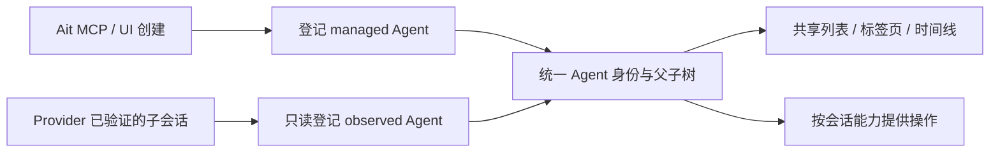

# ADR-209：通过只读登记统一子 Agent 展示

- 状态：Accepted。
- 日期：2026-10-31。
- 范围：Provider 子会话登记、Agent 目录、时间线、共享客户端。
- 关联：[ADR-040](adr-040-native-session-import-refresh-context.md)、
  [ADR-041](adr-041-agent-controls-provider-inspection.md)、
  [ADR-052](adr-052-native-provider-capabilities.md)、
  [当前架构](../../architecture/README.md)。

## 问题与决定

Ait 编排创建的子 Agent 与 Provider 原生子 Agent 应出现在同一棵树里，点击后查看各自
正在发生的事情。此前客户端合并两类列表，但原生子会话使用独立身份、标签页与时间线 store。
直接复用手动 import 或 refresh 会混淆观测与执行；refresh 还会先停止本进程 writer。

经 Provider 验证的原生后代现在自动登记为只读 `observed` Agent。Ait 创建或手动导入的
受管会话保持 `managed`。两者共用稳定 Ait ID、Agent 快照、父子树、标签页和时间线读取
接口，操作由会话实际能力决定。第一阶段没有 observed 转 managed 的操作。

本决策修订 ADR-041 与 ADR-052 中“原生子会话不登记宿主 Agent”的边界。原生执行、
凭据与日志仍归 Provider，登记只建立宿主展示身份。登记复用 Provider 已有的可信
子会话端口，包含 Codex、Claude 和主干新增的 OpenCode、OMP 观测。历史入口以 adapter
实际提供的读取能力和宿主缓存为准；其他 Provider 须先提供可信身份与直接父级。

## 身份、状态与持久化

[domain 观测值](../../../crates/domain/src/agent_runtime/observation.rs) 作为可选
`PersistedAgentRuntimeRecord.observation` 保存；旧记录缺省为受管会话。公共快照增加：

| 字段                                 | 含义                                                     |
| ------------------------------------ | -------------------------------------------------------- |
| `management`                         | `managed` 或 `observed`，不复用现有执行归属 `owner`。    |
| `parentAgentId`                      | 直接父级的 Ait ID，observed 的类型化关系优先于兼容标签。 |
| `observation.rootAgentId / nativeId` | 根观测通道及已验证原生子身份。                           |
| `observation.status`                 | `running / completed / failed / canceled / unknown`。    |
| `observation.health`                 | `current / stale / unavailable`，独立于已确认结果。      |
| `observation.revision / observedAt`  | 单调宿主版本及原生观测时间，防止旧列表响应覆盖最新状态。 |
| `observation.description / subtitle` | 任务描述与原生上下文。                                   |
| `capabilities`                       | 当前会话可执行的操作，客户端据此显示输入框和操作按钮。   |

私有观测记录另存根原生 session ID、直接原生父级、只读历史 locator 和 `ready`。
locator 不进入公共快照，也不写入可用于 resume 的顶层 persistence 字段。

[登记服务](../../../crates/provider/src/service/agent_manager/observed.rs) 按
`(provider, 根原生 session ID, 原生子 ID)` 的稳定哈希分配不透明 Ait ID。
跨主机仍由客户端 `(serverId, agentId)` 区分。标题、cwd、工具名不参与身份生成。
工具调用、任务与日志别名必须先由 adapter 验证；相同原生会话已有 managed 身份时
复用原 ID，保留其原生写入与流归属，不能降级为 observed。父级或身份冲突拒绝登记。

原生发现和 live announcement 使用同一幂等入口。只登记可达已验证根的后代，并按父级
顺序处理；不接纳外部会话。任务描述更新默认标题，用户手动改名后保留手动标题。
observed 不参与自动模型标题生成。子会话保留自己的 cwd，Workspace 展示归属继承根。

Agent 文件 registry 与 Timeline SQLite 没有跨存储事务：先写 pending 记录，再绑定
原 scope，最后置 ready。pending 不进入公共目录，重试和重启补齐同一 ID。
Timeline schema 7 在原 `provider_subagents` 表增加宿主 ID 与观测标志，不新增数据库，
不复制历史，不重置原 epoch/sequence。迁移按列存在性补齐 schema 5/6 的记录。
普通已绑定事件不重复扫描全目录；首次发现新身份才构建受管原生身份索引。

## 统一读取与兼容

新增 `agent.subagents.list.request` 返回直接子 Agent 的普通快照，同时包含 Ait 受管子级。
可选原生 `subagentId` 用于把已保存的旧标签页目标解析到同一 Ait ID。
`agent.timeline.*` 按 Ait ID 解析 observed 来源，继续读取原
`subagent:<root>:<native-child>` scope。历史读取经根校验 Provider、原生身份、直接父级和
目录，路由到根的观测通道；打开子标签页不会启动或恢复子 writer。

同一持久条目向普通 Agent 流与兼容子流发布，沿用 epoch、sequence 和条目身份。
已复用 managed ID 的子会话仍使用其自己的流，避免第二份流混入。
活动日志只能追加；明确完成的历史读取才参与 reconcile，防止局部日志截断缓存。
父前台 turn 结束不结算后台子任务。Workspace 活动统计继续使用原生描述符并排除重复的
observed registry 行，避免同一任务被计数两次。

客户端通过 `unifiedSubagentAgents` 能力协商切换。新 SDK 为目录、历史列表和目录订阅
自动发送 `includeObserved: true`；旧客户端缺省排除 observed，继续使用旧 RPC 和事件。
目录同步使用独立的 `:observed` generation，切换旧游标时返回完整快照。
新客户端把发现结果放入普通 Agent replica，列表、导航和时间线复用普通 Agent 路径。
旧 `provider_subagent` 标签页自动解析并跳转；未声明能力的旧 Host 仍使用兼容面板/store。
兼容代码在本阶段保留，移除需另行决策。

## 能力、归档与恢复

observed 支持元数据、只读时间线、后代导航和收起已确认终态记录。消息发送、取消、
审批应答、配置、rewind、refresh、脱离父级、独立 resume/import 和 finish-wait 均在
原生副作用之前拒绝。守卫同时覆盖 RPC、MCP、内部/voice 调用和 manager 入口；定时任务
解析和执行排除 observed，UI 目标选择器也不提供它。

关闭标签页只关闭展示；收起终态只修改 Ait 展示归档，不删除原生日志或调用原生 close。
活动或 unknown 子级不能单独收起。归档根时一并收起 observed 后代，保留原父子关系，
不会因打开标签页而把它们脱离成可写会话。再次发现保留归档；更新的运行事实可在根未归档
时重新显示子会话。

daemon 重启或客户端断线后将观测标为 stale，保留已确认原生状态与结果；本地进程缺失
不构成失败。Codex 仅报告 idle/notLoaded 时投影为 unknown，不据此合成成功。
原根归档、移除或原生身份变化后保留缓存历史，标记 unavailable，不接管子会话。
损坏或冲突的旧描述符保留在缓存并跳过规范化；存储 I/O 错误仍上报。

## 职责与验证

`domain` 只保存值和不变量；Provider 端口与 adapter 提供可信原生事实，Provider 服务
协调只读登记和投影；persistence 适配 Agent 文件 registry。Workspace 仍由 metadata
拥有，Provider 不新增对 metadata 或 persistence 的生产依赖。

聚焦回归覆盖稳定嵌套身份、managed 身份复用、跨存储中断恢复、旧 schema 升级、游标
保留、统一流、活动局部历史、父 turn 结束后的后台完成、原生 ancestry 拒绝、执行守卫、
终态归档、旧客户端隔离、客户端断线与版本防回退。浏览器真实 Provider 用例已更新为普通
Agent 面板断言，本次没有运行付费模型调用。详见
[实施与验证报告](../../reports/providers/unified-subagents-2026-10-31.md)。

## Test coverage

未测量代码覆盖率。本次运行变更代码及直接相关行为的聚焦测试；用户未要求全 workspace
测试或覆盖率，因此没有运行全量 Rust 测试和 workspace 覆盖率，也未生成覆盖率 artifact。
测试范围、结果和未执行项见实施与验证报告。
