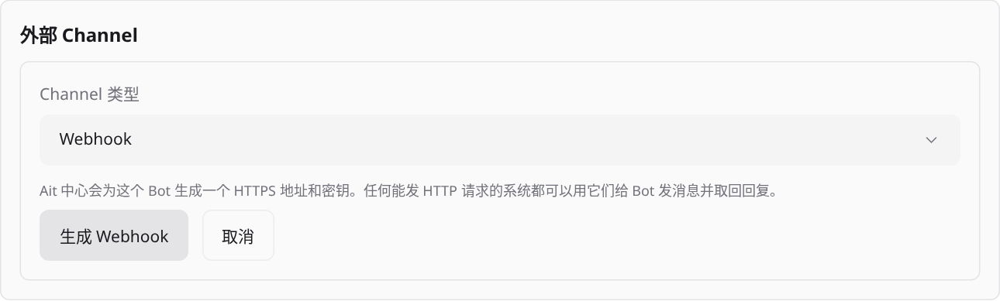
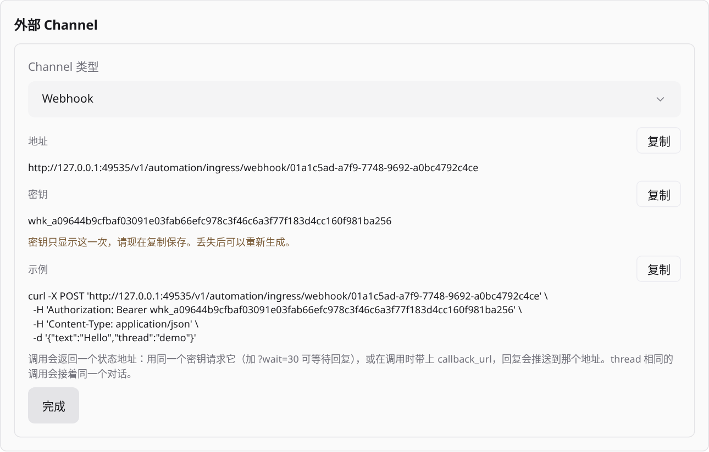
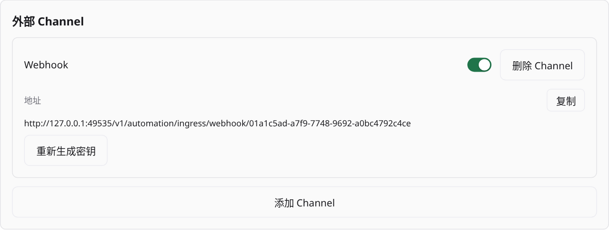

# Workspace Bot

每个 Workspace 至多一个管理者 Bot，使用独占 Channel 和隐藏 Provider session，由用户显式设置；未设置时不产生任何记录、会话、轮询或模型调用。
当前支持内置对话、Telegram、中国区飞书、国际版 Lark、微信（仅单聊）、QQ（单聊和群聊）与 iMessage（通过 Photon，仅单聊）；Email 尚未实现。设计见 [ADR-213](../decisions/bot/adr-213-single-workspace-manager-bot.md)，权限与 Ait 工具见 [ADR-215](../decisions/bot/adr-215-bot-permissions-and-scoped-mcp.md)。
客户端 Bot 标签页见 [ADR-214](../decisions/clients/adr-214-workspace-bot-tab-v2.md)，使用方式见下文“在 Ait 中使用”。

## 使用与生命周期

通过 `bot.setup` 指定 `workspaceId` 与 Provider 执行配置设置 Bot，同时生成内置 Channel；Bot 行为由内置管理者指令决定，不再有自定义人格。
相同配置重复设置幂等（`created:false`），配置不同且已有非退役 Bot 返回 `BotConflict`；用 `bot.update` 修改执行配置。
`clearMemory:true` 仅在新建 Bot 时清空记忆，幂等重复调用时忽略。
打开内置对话后发送消息，以稳定 `messageId` 重试可避免重复接纳。相同 ID 的目标或内容不同会返回冲突。
新建外部 Channel 默认停用，配置完成后显式启用，并检查 Channel 状态。

- 同一 Conversation 串行执行，不同发送者/线程的外部对话分开维护上下文。
- Provider 会话从创建起隐藏，普通 Agent API 无法接管；Bot 标签页将其列为子 Agent，可按完整 ID 只读查看（[ADR-221](../decisions/bot/adr-221-read-only-bot-session-inspection.md)）；关闭界面不停止 Bot。
- 配置在新 Conversation 或显式 reset 后生效。reset 前先完成或取消正在执行的轮次；排队中的输入随 reset 取消；旧历史保留。
- 状态为 `active`、`paused`（原因 `user` 或 `directory_missing`）、`retired`。暂停取消排队和执行中的输入并停止外部轮询；
  恢复要求 Workspace 目录存在，否则返回 `WorkspaceNotFound`。Workspace 目录缺失会在轮次可运行时检测，Bot 暂停为 `directory_missing`，需用户显式恢复。
- `bot.remove` 使 Bot 退役、保留记忆，并释放其外部账号（外部 Channel 标记为已删除）；Workspace 归档同样退役并删除记忆。
- 退役 Bot 的对话与历史仍留在磁盘上，但 v2 接口只读取当前未退役的 Bot，因此无法再查看；
  重新 `bot.setup` 从空的对话历史开始，记忆除非 `clearMemory:true` 否则保留。清理或只读访问退役历史留待后续工作。
- 所有 Provider 权限请求自动拒绝，不等待用户审批，见
  [ADR-145](../decisions/bot/adr-145-bot-permission-denial.md)；Bot 的 Ait 能力由下文“权限”授予。

输入落盘后才确认平台消息或推进游标；模型完成与平台投递是独立状态。
一次执行中的每条可见 assistant 消息都会进入同一个 turn 的 `messages` 数组并在运行期间更新；同一 `messageId` 的流式片段更新原消息，不同 `messageId` 保持独立。tool call、reasoning 和其他内部记录不会进入 Bot 对话。`reply` 仍保留为旧客户端读取最新消息的兼容字段。
重启时结果不明的运行输入标记 `uncertain`，阻止同 generation 的后续输入，需显式 reset；
不会自动重做可能产生副作用的输入。正在发送但未确认的回复也标记 `uncertain`，不盲目重发。
当前通过持久查询读取结果，尚无 Bot 流式事件订阅。
Bot 把工作交给 Agent 后即结束本轮，不在轮次中等待长时间的工作；交办的每项工作记为一个任务，
工作结束或需要用户时 Bot 被唤醒并在发起它的对话中回报，见下文“任务”与“通知与唤醒”。

## 在 Ait 中使用

Bot 标签页仍在“设置 → 关于”的测试功能开关之后，且要求 Host 支持 `workspace-bots-v2`，否则显示升级提示。

1. 开启测试功能后，在 Workspace 新建菜单选择 Bot；每个 Workspace 只有一个 Bot 标签页，重复打开会聚焦已有标签页。
2. 未设置时显示设置向导：选择 Provider、模型、权限模式与推理强度后提交；可勾选“清空已保存的记忆”，否则保留之前移除的 Bot 留下的记忆。
   访客只看到未配置提示。
3. 设置完成后进入对话，轮次显示状态与错误。由通知唤醒的轮次不显示为用户消息，见下文“通知与唤醒”；
   输入框上方的“任务”标签列出 Bot 正在做的工作，见下文“任务”。Bot 暂停时仍可查看对话历史（重新加载后也可），输入框停用，有管理权限的成员可点击恢复；
   目录缺失导致的暂停会说明原因。暂停期间记忆保存、Channel 新增与启停也停用，恢复后才能修改。
4. 在设置页可修改模型（对新对话生效）、选择唤醒范围并查看最近的通知、暂停或恢复、按 revision 编辑记忆、管理外部 Channel、移除 Bot。
   飞书 Channel 默认扫码接入，也可手动填写凭据，见下文“飞书接入”；Telegram 按页面引导粘贴 Token 并点击 Start，见下文“Telegram 接入”。两者都可改用 `env:AIT_SERVER_CREDENTIAL_*` 环境变量引用并配置允许的发送者；通过环境变量引用新建的 Channel 默认停用，确认配置与状态后再启用。移除需要确认。
5. 访客在所有视图中只读。重新设置被移除的 Bot（包括在其他设备上）得到空的对话与 Channel，客户端不会显示旧 Bot 的缓存内容。

## 通知与唤醒

处于 `active` 的 Bot 接收所在 Workspace 的事件通知，并据此执行“唤醒轮次”，在发起该工作的对话中回报
（[ADR-271](../decisions/bot/adr-271-bot-notification-inbox-and-wake-turns.md)）。未设置或暂停的 Bot 不接收通知，不产生任何调用。

**产生通知的事件**

- Agent 完成、失败或等待审批。Bot 自身的会话与已归档的 Agent 不产生通知。
- 定时任务每次运行的结果，成功或失败都有，包括创建 Agent 之前就失败的运行（如 `REVOKED`）。
  定时任务运行创建的 Agent 的完成、失败与等待审批都不单独通知，以运行结果为准：运行器遇到审批请求会取消该 Agent 并使运行失败，
  运行结果说明它在等待审批。
- 心跳（目标为已有 Agent 的定时任务）运行成功时不另发运行结果，由该 Agent 自己的完成通知报告；运行失败仍通知。
- 终端 attention。

**唤醒范围**

- “仅自己的工作”（`wakeScope: own`，默认）：Bot 启动的 Agent（含这些 Agent 再启动的 Agent）与 Bot 创建的定时任务的通知会唤醒 Bot。
- “此 Workspace 中的全部通知”（`all`）：Workspace 中其他 Agent、定时任务与终端的通知也会唤醒，模型调用会相应增多。终端通知只在此范围下唤醒。
- 范围外的通知只记入日志，Bot 在下一轮通过 `workspace_overview` 看到，不调用模型。
- 在设置页“通知”中修改，设置向导中也可选择；修改立即作用于之后的通知，访客只读。Host 未实现 `bot.notifications.list.request` 时客户端不显示该设置。

**回复去向**

- 唤醒轮次在发起该工作的对话中执行：在 Telegram 交办的任务，结果回到该 Telegram 会话。来源记录在 Agent 的保留标签
  `ait.bot.conversation` 与定时任务的 `botConversation` 字段，由 daemon 写入；Bot、它启动的 Agent 与 Ait MCP 调用都不能写入或修改。
- 没有来源（例如用户自己启动的 Agent）、来源对话已不可用（Channel 停用或删除、对话有 `uncertain` 轮次），
  或来源是 Webhook Channel 时，回到 Ait 主对话，即 Bot 标签页显示的对话。Webhook 只能返回调用方发起的轮次的结果，无法主动推送。
- 外部平台的投递方式：Telegram 发到原聊天与话题；飞书发到原聊天，不在话题内回复；QQ 以主动消息发送，
  受平台主动消息配额限制，被拒时投递记为 `uncertain`；微信不带上下文 token 发送。

**合并与限额**

- 同一目标对话的通知在最后一条到达后静默 3 秒，或最早一条已等待 30 秒时合并为一个唤醒轮次；
  目标对话有执行中或排队的输入时继续累积，结束后再唤醒。每轮至多 16 条，其余进入下一轮。
- 每个对话每小时至多 12 个唤醒轮次。超出后通知不再唤醒，记为未送达，在设置页“最近的通知”中可见，并出现在该对话下一轮的概览里。
- 每个 Bot 至多 64 条待唤醒通知，满时新通知记为未送达。
- 目标对话因中断（有 `uncertain` 轮次）需要重置时，通知不再等待，记为未送达（“对话已中断”），其他对话照常唤醒；
  重置该对话后，这些通知出现在它下一轮的概览里。
- Bot 在一轮中用 `wait_for_agent`、`get_agent_status` 或 `get_agent_activity` 读到某个 Agent 已结束时，该轮正常完成后，同一对话中关于该 Agent、
  不晚于所读状态的通知不再唤醒（设置页显示为“未重复唤醒”），避免把刚回报过的结果再报一次。
  该轮失败、被取消、中断或遇到 daemon 重启时，用户没有收到回报，这些通知照常唤醒；
  被取消的轮次里还在等待的 `wait_for_agent` 若到下一轮执行时才返回，不算作下一轮看过该结果，通知仍会唤醒。
  更晚的通知、其他 Agent、其他对话照常唤醒；daemon 重启后可能再唤醒一次。
  审批请求只有用 `wait_for_agent` 读到时才不再唤醒，用另外两个工具读到时仍会再唤醒一次。

**无需告知**：Bot 判断没有需要告诉用户的内容时以 `NO_REPLY` 作答，该轮记为 `silent`，不向任何外部 Channel 发送；
Ait 中显示为一行“无需告知”，流式输出期间也不显示该标记。只有唤醒轮次适用，用户消息的回复照常投递。

**在 Ait 中查看**：唤醒轮次在对话中显示为“Workspace 动态”标题和通知列表（每条的标题与摘要），而不是用户消息；
同一 Workspace 的 Agent 与定时任务可点击打开。设置页“最近的通知”列出最近 10 条通知及其去向（已唤醒、等待唤醒、不在唤醒范围内、未送达及原因）。
Bot 标签页尚不能查看外部对话，因此回到 Telegram 等平台的唤醒轮次只在该平台可见。

**暂停与重启**

- 暂停时等待中的通知记为未送达，恢复后不补发；暂停期间不接收新通知。
- 重启不会丢失已接纳的通知，也不会重复唤醒：已唤醒过的通知在 1 小时内再次到达都按重复处理。
  启动时只重放 15 分钟内仍需关注的 Agent attention，以及 15 分钟内结束的定时任务运行，更早的不再唤醒。
- 唤醒轮次执行中 daemon 关闭或崩溃时，这些通知在重启后重新唤醒一次；崩溃会使原对话需要重置，因此重新唤醒发生在 Ait 主对话中。
  用户自己取消或重置对话取消的唤醒轮次不会重来。
- daemon 关闭时被取消的定时任务运行，其结果在关闭前写入通知日志，重启后唤醒 Bot。只有在结算后、写入通知前崩溃，
  且 15 分钟后才重启时，该结果不会产生通知。

**已知限制**：`archiveOnFinish: false` 的定时任务 Agent 之后被复用时，其通知不再产生，因为它仍带定时任务运行标签。
心跳运行失败而目标 Agent 本身也报告失败时，Bot 会收到两条通知，通常合并在同一轮中。

**降级**：回退到不支持通知的旧版 daemon 时，只要 Bot 数据中有唤醒范围“全部”、唤醒轮次或带通知游标的轮次，daemon 就会因 Bot 数据无法加载而启动失败
（`start Bot service`）。Workspace 中任何 Agent 结束都会记入通知日志，此后 Bot 的每一轮几乎都会带上通知游标，
所以在有活动的 Workspace 中，降级实际上需要删除 `<data>/workspace-bots/`（Bot 的配置、对话与记忆随之删除）。
详见 [ADR-271](../decisions/bot/adr-271-bot-notification-inbox-and-wake-turns.md) 第 12 节。

**验证范围**：以上规则由 daemon 与客户端的单元和组件测试覆盖；唤醒回复尚未在 Telegram、飞书、QQ、微信等真实平台上验收，
移动端与桌面界面也未在真机上检查。

## 任务

Bot 交办的每项工作记为一个**任务**（协议与存储中称 ticket，[ADR-274](../decisions/bot/adr-274-bot-tickets-assignments-and-reports.md)）：
交办内容、在做它的 Agent、带日期的汇报，以及关闭时的结论。任务让 Bot 不必在一轮中等待 Agent，也让用户看到 Bot 正在为自己做哪些事。

**任务如何产生**

- Bot 每启动一个 Agent 就打开一个任务：标题为 Agent 标题，请求为 Agent 的初始提示，来源为发起的对话。
  同一次创建的重试（相同 `idempotencyKey`）只有一个任务；Agent 创建失败时不留下任务。
- Bot 为同一项工作再启动 Agent（重试、评审或并行的一部分）时指定已有任务，不另开任务。已关闭的任务需先重新打开，每个任务至多 16 个 Agent。
- 任务中的 Agent 再启动的 Agent 加入同一任务。用户自己启动的 Agent 与定时任务运行创建的 Agent 不属于任何任务。
- Agent 所属的任务记录在保留标签 `ait.bot.ticket` 中，由 daemon 写入；Bot、Agent 与 Ait MCP 调用都不能写入或修改。

**状态与谁来关闭**

| 状态        | Ait 中显示 | 含义                                                     |
| ----------- | ---------- | -------------------------------------------------------- |
| `open`      | 进行中     | 工作在进行                                               |
| `waiting`   | 等你处理   | 某个 Agent 在等待审批，或汇报受阻（`blocked`），需要用户 |
| `done`      | 已完成     | 已关闭：工作完成                                         |
| `failed`    | 失败       | 已关闭：工作失败                                         |
| `cancelled` | 已取消     | 已关闭：不再继续                                         |

- Agent 等待审批时任务进入 `waiting`，该 Agent 越过审批（完成或失败一轮）后回到 `open`。
- Agent 汇报 `blocked` 时任务进入 `waiting`，也包括它先请求过审批、或另一个 Agent 正在等待审批的情况（受阻优先于审批）。
  只要有 Agent 报告受阻，任务在该 Agent 之后再汇报、或 Bot、用户把任务设回进行中之前，不会回到进行中：Agent 结束这一轮不会解除受阻；
  几个 Agent 都受阻时，一个解除后任务继续等其余的。
- Bot（工具 `bot_ticket_update`）与用户能关闭任务（`done`、`failed`、`cancelled`，可附结论）或重新打开；设回进行中会解除所有受阻。
  Agent 结束一轮或汇报完成都不会关闭任务，因为 Bot 可能还要继续交代。已关闭的任务不能直接改为另一种关闭状态，需先重新打开；重新打开会清除结论。
  对已关闭的任务以同一状态再关闭并附上新结论时保存该结论，例如你先在 Ait 中关闭，Bot 随后附上总结。
- Ait 自己只在两种情况下改变任务，并在汇报中写明原因（来源显示为 Ait）：达到未关闭上限时自动关闭工作显然已结束的任务（见“上限”），
  以及 Bot 用 `send_agent_prompt` 给某个 Agent 更多工作时重新打开它已关闭的任务，使该 Agent 之后的汇报能被记录。
  新的任务需要新的 Agent；同一 Agent 的后续工作记在原任务上。
- 关闭或取消任务不会停止它的 Agent，需要时另行停止。

**Bot 的工作方式**

内置指令要求 Bot 把工作交给 Agent、告诉用户已开始，然后结束本轮，不在 `wait_for_agent` 中等待长时间的工作；只有预计一分钟内结束的工作才短暂等待。
Agent 完成、失败、等待审批，或汇报 `blocked`、`done`、`failed` 时，Bot 在交办该任务的对话中被唤醒（合并、限额与回复去向见“通知与唤醒”），
唤醒输入的每行标出所属任务。Bot 把结果告诉用户后用 `bot_ticket_update` 关闭任务，也可以改名或追加备注。
这些都是指令对模型的要求而不是强制规则：模型可能忘记关闭任务，用户可以在 Ait 中自行关闭，达到上限时 Ait 也会关闭 Agent 都已归档的任务。

Agent 先用 `report_progress` 汇报 `done`、`failed` 或 `blocked`，随后结束这一轮时，结束通知仍记入任务与通知列表，但不再唤醒 Bot
（设置页“最近的通知”中显示为未重复唤醒：Agent 已在任务中汇报过这一结果），一次完成只花一次模型调用。只在 Bot 已为同一结果被唤醒过时才这样：
之前某一轮的汇报不影响之后一轮（包括 Provider 自己继续的一轮，例如 Codex 的目标续跑）；汇报受阻后又汇报进展并继续工作的一轮、
汇报完成或受阻后失败的一轮、没有汇报就结束的一轮以及等待审批都照常唤醒。

**工作者汇报**

属于任务的 Agent 获得工具 `report_progress`（`kind` 为 `progress`、`blocked`、`done` 或 `failed`，`text` 1–2048 字符），Bot 在交办时要求它受阻或完成时调用。

- `blocked`、`done`、`failed` 唤醒 Bot；`progress` 只记入任务。
- 汇报不结束 Agent 的这一轮，也不关闭任务。
- 任务已关闭或 Bot 暂停时，汇报不被记录，Agent 会得到说明并照常完成工作。
- 带任务标签的 Agent 都能汇报，即使它没能加入任务的 Agent 列表（例如任务已有 16 个 Agent）；列表有空位时它在汇报时加入。
- 任务中 Agent 的完成、失败与等待审批也由 Ait 自动记入任务的汇报（来源显示为 Ait）。
- **审批**：Ait 把 `report_progress` 加入 Claude 工作者会话允许的工具（`--allowedTools`），Claude 不再为它请求审批；你自己允许的工具照旧保留。
  其他 Provider 的工作者没有这项预授权：Codex 在 `auto`、`auto-review` 模式中、其他 Provider 在会请求审批的模式中，
  可能先就 `report_progress` 请求审批：任务先进入“等你处理”，Bot 被唤醒说明需要审批，你批准后汇报才记录。Codex `full-access`、`read-only` 不请求。
  原因见 ADR-274 第 10 节（Codex 的预授权会限制工作者能用的其他 Ait 工具，其他 Provider 不接受预授权）；此行为只按代码判断，尚未用真实 Provider 验证。

**上限**

- 每个 Bot 至多 32 个未关闭的任务。达到上限时，Bot 启动新 Agent 前 Ait 先自动关闭工作显然已结束的任务：至少有一个 Agent、且它的 Agent 全部已归档或已删除。
  进行中的任务只在最近一次重新打开之后、它的每个 Agent 最近一条汇报都是 `done` 时关为已完成，其余关为已取消；
  等你处理的任务（受阻或等待审批）此时已无人能继续或回答，关为已取消。结论写明是自动关闭及原因。
  Ait 读不全 Agent 列表时不关闭任何任务。仍没有空位时 Bot 不能再启动 Agent，会得到“列出任务并关闭已完成或不再需要的任务”的提示。
  你或 Bot 重新打开任务同样受此限制（不做自动关闭），Ait 中会说明原因。Bot 给 Agent 更多工作时，其已关闭任务的重新打开也会先做上述自动关闭；
  仍不能重新打开时提示照常发送，Bot 会被告知该任务未重新打开、Agent 对这项工作的汇报会被拒绝。提示发送失败时任务仍保持重新打开。
- 已关闭的任务保留最近 64 个，更早关闭的自动删除。
- 每个任务至多 16 个 Agent，保留最近 32 条汇报；标题 256 字节、请求 4096 字节、结论与每条汇报 2048 字节，超出部分截断。

**在 Ait 中查看**（Host 实现 `bot.ticket.*` 时；否则不显示任务，客户端也不发送任务请求）

- 对话输入框上方的“任务”标签显示进行中的任务数，有等你处理的任务时另显示其数量。点开后列出未关闭的任务，等你处理的在前；
  每项显示标题、状态（等待时说明原因：Agent 等待你的审批，或 Agent 受阻需要你的输入）、Agent 数与最近一条汇报。
  已关闭的任务默认不显示，点“显示最近关闭的任务”另行加载。
- 点开任务查看状态、关闭后的结论、请求、Agent（同一 Workspace 中的可点击打开）与按时间顺序的汇报记录，每条注明来源（Agent、Bot、你或 Ait）。
- Host 所有者可以标记完成、取消任务（需要确认）或重新打开已关闭的任务，结论可选填；Bot 暂停时也可以。访客只读。
- 唤醒卡片中属于任务的通知另显示“任务：标题”，点击打开该任务。
- 列表约每 10 秒刷新，打开的任务约每 5 秒刷新。

**暂停、移除与重启**

- 暂停保留任务。暂停期间不记录汇报，Bot 不能打开或修改任务（因此不能启动属于任务的 Agent），用户仍可关闭、取消或重新打开。
  暂停期间由任务中的 Agent 启动的子 Agent 仍带任务标签，恢复后第一次汇报时才出现在任务中。
- `bot.remove` 与 Workspace 归档删除该 Bot 的全部任务；之后重新设置的 Bot 从没有任务开始。
- 重启不改变任务。少数崩溃窗口会留下痕迹：打开任务后、创建 Agent 前崩溃，会留下没有 Agent 的进行中任务，需由 Bot 或用户关闭（自动关闭不处理没有 Agent 的任务）；
  也可能重复一条 Ait 自动汇报。工作者汇报已保存而唤醒尚未记录时崩溃，重启时补发 1 小时内的这类唤醒，已唤醒过的不重复。
- Bot 创建 Agent 超过 60 秒调用时限时，Bot 收到超时错误，但 Agent 的创建与任务的收尾照常完成；Bot 若随即重试，可能多出一个任务。
  这样的创建仍占用 MCP 调用额度直到结束，至多再运行 5 分钟，超过时被放弃，可能像崩溃一样留下没有 Agent 的任务。
  daemon 关闭时不会取消它：创建若在关闭时仍卡住，关闭会等满 15 秒期限后报错（未复现）。

**降级**：0.2.10 及更早的 daemon 忽略任务数据，但无法解析含 `ticket_blocked`、`ticket_done`、`ticket_failed` 或跳过原因 `reported` 的通知日志与唤醒轮次，
Bot 数据加载失败，daemon 启动报错 `start Bot service`。只要有 Agent 汇报过 `blocked`、`done` 或 `failed`，降级就需要删除 `<data>/workspace-bots/`，
与上文通知的降级相同。本版本同样不能读取以后新增的任务状态、等待原因或汇报类型。

**验证范围**：以上规则由 daemon 的单元与集成测试覆盖，包括以伪执行器跑通的“Bot 启动 Agent → 打开任务 → Agent 汇报 `done` → 原对话被唤醒”循环、
达到上限时的自动关闭、`send_agent_prompt` 重新打开任务，以及每个写入点的崩溃恰好唤醒一次；
任务界面由客户端组件测试覆盖。真实 Provider 会话中模型是否按指令交出工作、要求 Agent 汇报并关闭任务，尚未在运行中的 daemon 上验证；
任务界面也未在真机或桌面应用中检查。

## 权限

Bot 通过 Ait MCP 工具管理 Workspace，可用工具由用户授予的**分组**决定。分组整体替换保存，在 Bot 的下一次 MCP 请求生效，
工具目录和指令在 Bot 下一轮刷新。

| 分组        | 内容                                                                    | 默认 |
| ----------- | ----------------------------------------------------------------------- | ---- |
| `observe`   | 查看 Agent、定时任务、脚本、终端、Provider 与模型（总是开启，不可关闭） | 是   |
| `agents`    | 创建 Agent、发送提示、修改 Agent 设置与模式                             | 是   |
| `stop`      | 取消、归档、终止 Agent                                                  | 是   |
| `schedules` | 创建、修改、暂停、恢复、运行、删除定时任务与心跳                        | 是   |
| `scripts`   | 启停 Workspace 脚本                                                     | 否   |
| `terminals` | 创建终端、发送按键、读取并终止终端                                      | 否   |

`create_workspace`、`respond_to_permission`、`archive_workspace`、`rename_workspace`、`list_workspaces` 永不授予 Bot，Bot 不能通过 Ait MCP 创建 worktree 或 Workspace（[ADR-222](../decisions/bot/adr-222-single-agent-mode-no-bot-workspaces.md)）。
`bot_memory_read`、`bot_memory_update`、`bot_tickets`、`bot_ticket_update`、`workspace_overview`（作用域概览，含未关闭的任务，输出上限 24 KiB）只对 Bot 自己可见；
`report_progress` 只对属于任务的 Agent 可见。

**Agent 模式**为每个 Provider 选择一个原生模式（至多 32 个 Provider），Bot 与它启动的 Agent 只能使用该模式；
未列出的 Provider 不能被使用。阶段 1／2 创建的 Bot 升级后得到默认分组但模式上限为空，不能启动 Agent，需在设置中配置。
上限约束 Bot 与子树设置或创建的每一个模式。允许能运行命令的模式或 `terminals` 分组时，这些 Agent 与终端命令可读取本机 daemon 凭据并绕过 Bot 的 Ait 限制，
设置页与向导在模式上限部分和终端分组下显示此警告。只读模式不阻止读取：即使 Codex `read-only` 下的 Bot 也能读取 `local-api.token`（见 ADR-215）。

**作用域**为 Bot 所在 Workspace，加上此前已创建且未归档的 worktree（升级前的 Bot 可能留有记录）。Bot 可向作用域内的任何 Agent
发送提示、修改设置，也可运行、暂停、恢复或删除任何定时任务（含用户启动和创建的），但受已授权分组与模式上限约束；
`update_schedule` 只能编辑 Bot 创建的定时任务，用户创建的任务需由用户自己修改；
向用户启动的 Agent 发送提示可能触及超出 Bot 自身限制的能力，这是已接受的风险（见 ADR-215）。

**Bot 模型的降级。** Bot 可使用任何 Provider。Codex 与 Claude 使用只读模式（Codex `read-only`；Claude `default`，仍把写入路由到审批的最严格模式，
用户与项目的允许规则照常适用）、系统提示和 Ait 工具预授权。其他 Provider 使用默认模式，指令前置到每一条输入，
需要审批的写入与 Ait 工具调用被自动拒绝；Provider 不经审批执行的写入不会被阻止，不支持 HTTP MCP 的 Provider 没有 Ait 工具。
设置页以能力说明显示这些差异。已有会话无法达到安全配置时，Bot 自动轮换一次对话。

客户端以 `bot.permissions.update.request` 是否实现决定是否显示权限设置；服务端 `bot.setup` 可携带可选 `permissions`，
`BotView.permissions` 返回当前配置。更新示例（参数整体替换，访客不可调用）：

```json
{
  "workspaceId": "<workspaceId>",
  "permissions": {
    "groups": ["observe", "agents", "stop", "schedules", "scripts"],
    "modes": { "codex": ["read-only", "auto"], "claude": ["default"] }
  }
}
```

### Bot 启动的 Agent

Bot 创建的 Agent 带保留标签 `ait.bot.scope`、记录发起对话的 `ait.bot.conversation` 与所属任务的 `ait.bot.ticket`，其会话获得派生凭据，只能访问同一作用域并受同一模式上限约束，无 Bot 专属工具（属于任务时另有 `report_progress`）；
作用域调用者不能写入任何 `ait.` 前缀的标签。Bot 暂停期间这些 Agent 保留完整授权（只有 Bot 自身的凭据失效）；Bot 移除后降为只读观察；
同一 Workspace 设置新 Bot 后，新 Bot 的授权适用于该 Workspace 已有的这些 Agent 与定时任务。

Bot 创建的定时任务记录 `botScope`（根 Workspace，而不是某个 Bot），每次运行前按当前授权复核；不再被允许时该次运行失败，任务保持启用。
没有当前 Bot 时（例如 Bot 已移除），这些任务的每次运行都以 `REVOKED` 错误失败；同一 Workspace 设置新 Bot 后，它们按新 Bot 的授权运行。
Bot 运行或恢复模式超出上限的任务会被拒绝；没有存储模式的用户任务需由用户先设置允许的模式。
凭据细节见 [MCP](mcp.md#bot-与子树凭据)。

## Telegram、飞书与 Lark 配置

飞书推荐扫码接入，Telegram 推荐引导接入，都无需下面的配置。使用环境变量时，凭据由启动 daemon 的宿主环境注入，Channel 仅保存引用。
以下为非秘密配置示例，替换允许的用户 ID 后再启用。

```json
{
  "kind": "telegram",
  "tokenRef": "env:AIT_SERVER_CREDENTIAL_TELEGRAM",
  "allowedSenders": ["123456"],
  "allowGroups": false
}
```

Telegram 使用 getUpdates 长轮询。已有 webhook 会报告冲突，不会自动删除；
当前只处理文本，不处理附件或编辑消息。

```json
{
  "kind": "feishu",
  "appId": "cli_example",
  "secretRef": "env:AIT_SERVER_CREDENTIAL_FEISHU",
  "allowedSenders": ["ou_example"],
  "allowGroups": false
}
```

### Telegram 接入

在 Bot 设置页添加 Telegram Channel，按页面步骤在 BotFather 创建机器人并粘贴 Token，daemon 向 Telegram 验证后显示一个二维码和链接。打开后在机器人对话中点击 Start，你会成为唯一允许的发送者，Channel 随后自动启用；群聊需在继续前勾选。链接 10 分钟后过期，daemon 重启后需重新开始。
配对期间发给该机器人的其他消息会被丢弃。Token 与飞书 App Secret 保存在同一位置，边界相同。

### 微信接入

在 Bot 设置页添加微信 Channel，点击“显示二维码”，用微信扫码并在手机上确认，Channel 随后自动启用。只有扫码者可以在单聊中给机器人发消息，不支持群聊，也没有手动接入。
微信结束会话后 Channel 显示已过期，需删除后重新扫码。此流程依赖未公开的 iLink 接口，边界见 [ADR-225](../decisions/bot/adr-225-weixin-and-qq-channels.md)。

### QQ 接入

在 Bot 设置页添加 QQ Channel，点击“显示二维码”，用 QQ 扫码并同意，Channel 随后自动启用，只有扫码者可以私聊机器人；群聊需在扫码前勾选。
扫码不可用时可选择手动填写 App ID 与 App Secret，daemon 向 QQ 验证后保存。

手动接入的 Channel 起初没有允许的发送者，开启群聊的 Channel 也可能无法在群里识别扫码者。此时在该 Channel 所在行点击“获取配对码”，把配对码私聊发给机器人，或在群里 @ 机器人并发送它，发送者即加入允许列表。配对码只能使用一次，10 分钟后过期，daemon 重启后失效。

QQ 限制被动回复的时间和次数，超出后 Ait 改用主动消息；在 QQ 中关闭机器人的“允许主动发送”后，这部分回复会发送失败。
如果群主开启了“接收群内全部消息”，QQ 会用 `GROUP_MESSAGE_CREATE` 推送群内消息，Ait 会把这些普通消息也送进 Bot；未开启时继续使用 `GROUP_AT_MESSAGE_CREATE`，只接收 @ 机器人的消息。

### iMessage 接入

iMessage 通过 Photon Beta 2.0 的托管线路收发，消息内容经过 Photon 的云服务，不需要 Mac，边界见 [ADR-226](../decisions/bot/adr-226-photon-imessage-channel.md)。

先在 [Photon 控制台](https://app.beta.photon.codes)创建项目和 API Key，Key 需要 `project:read`、`project:write`、`platforms:read`、`platforms:write` 权限。然后在 Bot 设置页添加 iMessage Channel，填写 Project ID、API Key 和你自己的手机号（E.164）或 iMessage 邮箱。daemon 分配一条共享线路并显示号码和一次性代码，从填写的身份用 iMessage 把代码发给该号码，Channel 随后自动启用，只有该身份可以给 Bot 发消息。代码 10 分钟后过期，daemon 重启后需重新开始。

当前只处理单聊文本，不支持群聊和附件，也不支持 Photon 的专用线路。回复被 Photon 接受即显示为已投递，最终失败只能在 Photon 控制台看到。删除 Channel 不释放线路分配。已用真实 Photon Beta 项目验证单聊往返，移动端设置页尚未在真机上验证。

Channel 存在后回退到旧版 daemon 会导致 daemon 无法启动，即使 Channel 已删除，详见 ADR-226。

### 飞书接入

在 Bot 设置页添加飞书 Channel，点击“显示二维码”，用飞书 App 扫码并同意。daemon 直接向飞书创建应用，无需开发者后台操作；
完成后 Channel 自动启用，只有扫码者可以给机器人发消息，群聊需在扫码前勾选。二维码由 daemon 按飞书返回的有效期管理，daemon 重启后需重新扫码。
扫码不可用（例如企业禁止创建应用）时选择手动填写，按页面步骤创建应用，粘贴 App ID 与 App Secret，并填写发送者的 Open ID；daemon 向飞书验证后保存。也可填写 `env:` 引用。

扫码或粘贴的 App Secret 保存在 `<data>/workspace-bots/credentials/<channelId>`（Unix 上仅所有者可读），删除 Channel 或移除 Bot 时一并删除；飞书上的应用需在开发者后台自行删除。
同一用户运行的进程可以读取此文件，边界见 [ADR-224](../decisions/bot/adr-224-feishu-scan-onboarding-and-stored-secrets.md)。

飞书使用自建应用机器人，配置 IM 接收/发送权限，订阅 `im.message.receive_v1` 并选择长连接。
默认只接收允许列表中的发送者；群聊需显式开启并提及机器人。当前不支持富媒体和卡片流式回复。
同一 daemon 内限制平台账号独占，无法阻止其他服务使用同一账号。
实际平台凭据和应用权限需要单独验收，历史模拟服务测试不能证明真实账号已验证。

### Lark 国际版接入

在 Bot 设置页添加 Channel 并选择 **Lark**，手动填写国际版自建应用的 App ID、App Secret
和允许发送消息的用户 Open ID（`ou_...`）。daemon 向 `open.larksuite.com` 验证凭据后保存并启用
Channel；凭据存储与清理沿用飞书规则。Lark 入口要求主机支持 `bot.channel.lark.connect.request`，
旧主机需升级后才能显示。

1. 在 [Lark 开发者后台](https://open.larksuite.com/app)创建自建应用，开启机器人能力。
2. 添加 `im:message:send_as_bot`、`im:message.p2p_msg:readonly`、`im:message.group_at_msg:readonly` 权限。
3. 在 Ait 中填好上述信息并添加 Channel，然后在应用的事件与回调设置中选择长连接，订阅 `im.message.receive_v1`。
4. 发布应用版本，使用允许列表内的账号向机器人发消息。群聊需在 Ait 开启群聊并 @ 机器人。

也可用环境变量引用配置，通过 `bot.channel.create.request` 创建，再启用 Channel：

```json
{
  "kind": "lark",
  "appId": "cli_example",
  "secretRef": "env:AIT_SERVER_CREDENTIAL_LARK",
  "allowedSenders": ["ou_example"],
  "allowGroups": false
}
```

Lark 与飞书配置分别连接各自区域，不能通过修改已有 Channel 的类型切换；请新建对应类型。
Lark 接入目前仅以本地模拟服务验证，真实账号和区域长连接可用性仍需验收；应用必须能启用长连接，
尚未提供 Lark 平台事件的 Webhook 接收方式。飞书二维码不用于创建 Lark 应用。
新增类型的升级与降级限制见 [ADR-272](../decisions/bot/adr-272-lark-channel.md)。

### Webhook Channel

在 Bot 设置页添加 Webhook，Ait 中心会生成一个 HTTPS 地址和一次性密钥，见 [ADR-233](../decisions/bot/adr-233-webhook-channel-center-endpoints.md)。daemon 只保存端点 ID 和 URL；密钥丢失时使用「重新生成密钥」，旧密钥立即失效。

调用方 POST 文本到该地址，使用 `Authorization: Bearer <密钥>`，取得 202 和状态地址。用同一密钥请求状态地址，加 `?wait=30` 可等待结果；也可以在调用中带 `callback_url`，由中心把带 HMAC-SHA256 签名的结果 POST 到 HTTPS 公网地址。同一 thread 续接同一 Bot 会话，不带 thread 时每次独立。

中心经现有 serve 链路投递消息、读取轮次并确认送达，只能访问已启用的 Webhook Channel。停用 Channel、暂停或移除 Bot 会立即收回权限。删除 Channel 时尽力删除中心端点；创建和轮换遇到中心离线等情况会明确显示失败原因。

以下为本地隔离环境截图，图中的回环地址和一次性密钥均已失效。

添加 Webhook：



创建结果包含一次性密钥、curl 示例及 poll/push 提示：



创建后的 Channel 可以复制地址、切换启用状态和重新生成密钥：



## 记忆与接口

Bot 记忆位于 `<data>/workspace-bots/memory/<sha256(workspaceId)>.md`，限制 32 KiB，不再写入 Workspace 目录。
每轮读取并提供给原生会话；客户端通过 `bot.memory.update` 更新，revision 防止覆盖旧内容。
Bot 自身通过 `bot_memory_read`／`bot_memory_update` 读写记忆（携带 revision，冲突时重读）；内置指令把记忆放在 `<workspace-memory>` 围栏内并声明为用户数据。移除 Bot 保留记忆，Workspace 归档删除记忆。

接口通过认证 WebSocket 协商 `workspace-bots-v2`，所有方法以 `workspaceId` 寻址，客户端 JSON 不含内部 `botId`。常用流程为
`bot.setup.request` → `bot.conversation.open.request` → `bot.message.send.request`，
再以 `bot.turn.get.request` / `bot.history.get.request` 读取执行与投递状态；`bot.get` 在未配置时返回 `null`。
其余方法：`bot.update`、`bot.pause`、`bot.resume`、`bot.remove`、`bot.channel.*`（含 `bot.channel.feishu.scan.{start,status,cancel}`、`bot.channel.feishu.connect`、`bot.channel.telegram.pair.{start,status,cancel}`、`bot.channel.weixin.scan.{start,status,cancel}`、`bot.channel.qq.scan.{start,status,cancel}`、`bot.channel.qq.connect`、`bot.channel.qq.pair`、`bot.channel.imessage.pair.{start,status,cancel}` 与 `bot.channel.webhook.{create,rotate}`）、`bot.conversation.{list,reset}`、
`bot.turn.cancel`、`bot.memory.get`，读取通知日志的 `bot.notifications.list`（可选 `unseenBy` 只返回某对话尚未在完成轮次中看到的通知），
以及任务的 `bot.ticket.{list,get,update}`（`update` 只接受 `open`、`done`、`failed`、`cancelled` 与可选结论，访客不可调用）。`bot.create`、`bot.list`、`bot.archive`、`bot.permission.resolve` 已删除。
`bot.channel.lark.connect` 提供 Lark 手动接入。基础 Channel 类型通过 `bot.channel.types.request` 查询，
新增平台按各自的接入方法发现能力；完整参数见
[`protocol.rs`](../../crates/bot/src/protocol.rs)，实现归属见
[ADR-213](../decisions/bot/adr-213-single-workspace-manager-bot.md) 与
[ADR-139](../decisions/bot/adr-139-workspace-bots-and-owned-channels.md)。

## 从旧版升级

旧版多 Bot 数据不迁移：daemon 启动时关闭 `<data>/bots/` 中记录的隐藏会话并删除该目录，之后用 `bot.setup` 重新设置。
旧版写在 `<workspace>/.ait/bots/` 的记忆文件不再读取，可手动删除。

旧设计、完整 RPC 示例与历史验证见[归档](../archive/plans/bot-backend.md)，未实现能力见[计划索引](../plans/README.md)。
