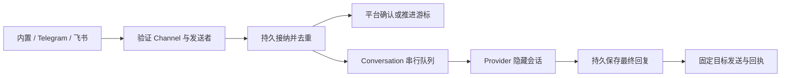

# Bot 后端设计与接口

Bot 是 Workspace 内长期存在的对话实体。每个 Channel 属于一个 Bot，入站消息直接通过
Channel 找到归属；Conversation 管理隐藏 Provider session，普通 Agent 目录不展示它。
边界决策见 [ADR-138](../decisions/bot/adr-138-workspace-bots-and-owned-channels.md)。

本次实现后端服务与接口。前端 Bot tab 尚未接入，Telegram、飞书使用本地模拟服务验证；
真实账号需要配置凭据和平台应用后验收。Email 仅完成可行性设计。

## 数据与边界

| 位置                        | 当前职责                                                     |
| --------------------------- | ------------------------------------------------------------ |
| `domain::bot`               | Bot、Channel、Conversation、Turn、执行与投递状态             |
| `model::bot`                | 原子存储端口、逐条扫描历史、Workspace 记忆路径               |
| `bot`                       | 独立运行时、RPC、路由、串行对话、Channel adapters            |
| `provider`                  | `AgentExecution::bot` 所有权校验、创建即隐藏、原生执行与恢复 |
| `persistence::storage::bot` | 本地 JSON 记录与 Markdown 记忆                               |
| `api`                       | 鉴权连接、能力协商、服务安装、Workspace 归档协调             |
| `daemon`                    | 文件路径、环境凭据解析、registry 与服务装配                  |

`bot` 的生产内部依赖为 domain/model/provider，具体 persistence 由 daemon 注入。
Provider 不引用 bot。平台接入复用现有 HTTP、WebSocket、TLS 和 Tokio；新增 `prost`
仅用于飞书 protobuf 帧，不引入外部数据库、Redis、消息队列或 Node/Go 进程。

Bot 保存 Workspace ID、名称、人格 instructions、Provider 选择、内置 Channel 和启用/
归档状态。Channel 保存不可迁移的 botId、类型、非秘密配置、允许列表和收件游标。
Conversation 保存 Channel、peer、sender、thread、generation、配置快照和私有执行身份。
Turn 保存消息去重键、顺序、generation、原始回复目标、正文、最终回复、审批和投递状态。

创建使用客户端预分配 UUID 的 botId/channelId。重复创建相同内容返回原对象，不同内容
返回 `idempotency_conflict`。Bot 与内置 Channel 原子创建；内置 Channel 不能删除。
删除第三方 Channel 保留历史归属，后续不再接收或发送。

默认路由键为 `(channelId, peer, sender, thread)`，群聊中不同发送者拥有独立上下文。
Telegram 账号与飞书应用的租户范围由 Channel 固定。内置 Channel 使用稳定 `owner`
对话，跨 tab、设备与连接复用；客户端自报 ID 不作为认证身份。

配置更新在新 Conversation 或显式 reset 后生效。reset 需要先结束或取消正在执行的轮次，
并取消排队输入；旧历史保留，generation 增加，隐藏 session 身份旋转。

## 执行与恢复



Provider 在首次登记前同时设置 `internal` 和 Bot/Conversation/Workspace 所有权。每次
私有操作校验所有权，普通 Agent 方法不能通过 ID 或原生恢复句柄接管会话。原生发现也
过滤已归档的内部 session。Bot 复用 Provider 的输入回执、恢复、执行 lane 和工具审批，
不再实现一套模型循环。轮次结束后释放空闲原生进程，保留可恢复身份。

暂停会取消排队和执行中的输入，保留会话身份；重新启用可继续同一 Conversation。
归档才退役当前会话。拒绝正在运行的 reset 不会隐式取消轮次。

同一 Conversation 依次执行，不同 Conversation 最多 32 个后台轮次；Provider 保留自身
全局资源限制。最多 512 个待执行输入、每个 Conversation 32 个排队输入。单条输入
16 KiB，最终回复 256 KiB，历史每页最多 50 条且 JSON 总量不超过 2 MiB。

`messageId` 在 Channel 内去重。相同目标和内容重发返回原回执，目标或内容改变则冲突。
平台确认发生在接纳落盘之后，不等待模型完成。权限等待通过 Turn 的 pendingPermissions
呈现，由认证的 Ait 客户端调用审批接口，第三方正文不能直接批准工具执行。

执行状态为 queued/sending/running/needs_approval/completed/failed/uncertain/cancelled；
投递状态为 pending/sending/delivered/uncertain。重启时 sending、running 或权限等待的
执行标记为 uncertain，阻止同 generation 的后续输入执行，需显式 reset；不会自动重做
可能包含副作用的输入。完成且尚未发送的回复继续投递，正在发送的回复恢复为 uncertain。
发送超时不盲目重发；首次实现不提供 uncertain 投递的自动重试或 exactly-once 承诺。

配置写入或回执写入结果不明确时冻结 Bot 服务的新工作，需重启检查。历史逐文件保存，
启动逐条扫描，只在内存中保留路由和回执索引，避免每次输入重写全部历史。目录扫描忽略
原子写入的临时文件。Workspace 归档先停用 Bot 后退役 Provider；关闭 UI 连接不停止 Bot。
记忆读取失败只将对应输入标记 failed，不阻塞其他 Bot。

## Workspace 记忆

```text
<workspace.cwd>/.ait/bots/<sha256(workspaceId)>/<botId>/MEMORY.md
```

同一个 cwd 下的不同 Workspace 仍拥有独立命名空间。首版提供每个 Bot 一份共享长期
记忆，限制 32 KiB；人格与 Conversation 配置快照保存在 daemon 的 Bot 记录中。
每轮加载记忆并更新原生系统提示，同时告知模型文件位置，允许现有文件工具维护它。

memory.update 使用内容摘要 revision 防止 Ait 客户端覆盖过期内容；文件适配器原子写入，
拒绝目录符号链接和越界路径。API 的 revision 不能协调其他进程直接编辑文件，也不提供
原生文件工具沙箱。发送者私有记忆、Conversation 摘要和全文检索可后续扩展；首版不自动
把全部对话写入共享记忆。worktree 删除仍会删除其本地记忆，保留需求应在删除前备份。

## RPC

通过现有认证 WebSocket 的 request envelope 调用。安装后广告 `workspace-bots-v1` 和
以下方法，bot.channel.types 返回 supported 与 Email 的未支持声明。

| 方法                             | 参数与行为                                                     |
| -------------------------------- | -------------------------------------------------------------- |
| `bot.create.request`             | botId、workspaceId、name、instructions（可省略）、execution    |
| `bot.list.request`               | workspaceId；返回轻量 Bot 列表                                 |
| `bot.get.request`                | botId；返回完整配置                                            |
| `bot.update.request`             | botId；可选 name/instructions/execution/enabled                |
| `bot.archive.request`            | botId；停止工作，保留记录                                      |
| `bot.channel.types.request`      | 空对象；支持 builtin/telegram/feishu，Email 未支持             |
| `bot.channel.list.request`       | botId                                                          |
| `bot.channel.create.request`     | botId、channelId、config、enabled（默认 false）                |
| `bot.channel.update.request`     | botId、channelId、enabled、可选 config；账号身份与类型不可迁移 |
| `bot.channel.delete.request`     | botId、channelId；保留历史                                     |
| `bot.channel.status.request`     | botId、channelId；连接状态与安全错误                           |
| `bot.conversation.open.request`  | botId；打开或复用内置 owner 对话                               |
| `bot.conversation.list.request`  | botId；公开映射不含 Provider session ID                        |
| `bot.conversation.reset.request` | botId、conversationId；显式开始新 generation                   |
| `bot.message.send.request`       | botId、conversationId、messageId、text；只允许内置 Channel     |
| `bot.history.get.request`        | botId、conversationId、可选 afterSequence/limit                |
| `bot.turn.get.request`           | botId、turnId；读取执行、审批与投递回执                        |
| `bot.turn.cancel.request`        | botId、turnId；取消排队输入或请求取消当前轮次                  |
| `bot.permission.resolve.request` | botId、turnId、permissionId、原生 response                     |
| `bot.memory.get.request`         | botId；返回 text/revision                                      |
| `bot.memory.update.request`      | botId、text、expected（上次 revision）                         |

内置对话示例：

```json
{
  "type": "request",
  "request_id": "create-bot",
  "method": "bot.create.request",
  "params": {
    "botId": "65166e7e-190a-43e0-9c3d-922608024e2e",
    "workspaceId": "wks_0123456789abcdef",
    "name": "Workspace assistant",
    "instructions": "帮助我处理这个工作区中的任务。",
    "execution": { "provider": "codex", "model": null, "modeId": null, "thinking": null }
  }
}
```

随后 open 获取 conversationId，send 使用稳定 messageId，turn.get 或 history.get 读取
后台结果。首版提供持久查询，尚未实现流式事件订阅与前端 tab 渲染。安全错误使用
bot_not_found/bot_conflict/bot_io 及既有通用错误码。

## Telegram 与飞书

Telegram config 为 `{"kind":"telegram","tokenRef":"env:AIT_SERVER_CREDENTIAL_TELEGRAM",
"allowedSenders":["123456"],"allowGroups":false}`。凭据环境变量由启动 daemon 的宿主注入，
配置只保存引用。接收使用 getUpdates 长轮询，输入/忽略决定落盘后才推进 offset。
已有 webhook 会报告冲突，不能自动删除；显式 429 根据 retry_after 有限重试，文本按 Unicode
边界分块并回复原始消息/话题。原始 HTTP 错误与 token-bearing URL 不进入公共错误。
[Telegram Bot API](https://core.telegram.org/bots/api#getupdates)

飞书 config 为 `{"kind":"feishu","appId":"cli_example",
"secretRef":"env:AIT_SERVER_CREDENTIAL_FEISHU","allowedSenders":["ou_example"],
"allowGroups":false}`。使用中国区飞书自建应用，开通机器人和 IM 接收/发送权限，订阅
`im.message.receive_v1` 并选择长连接。默认只接收明确允许的用户；群聊需要开启且提及机器人。

Adapter 完成端点发现、TLS WebSocket、protobuf 帧、心跳、重连、分片重组、持久接纳后确认，
tenant token 只缓存于内存。事件 ID 去重，最终文本通过 IM API 回复原始消息/线程，使用
稳定分块 uuid；平台未确认的发送保留 uncertain。协议参考固定官方 Go SDK 提交
`99927aa13e271ea9fe03591204aad7bc6a2d869c`，实现为 Rust，未引入该 SDK 进程。
[官方 Channel 文档](https://github.com/larksuite/oapi-sdk-go/blob/v3_main/doc/channel.md)、
[官方帧协议](https://github.com/larksuite/oapi-sdk-go/blob/99927aa13e271ea9fe03591204aad7bc6a2d869c/ws/pbbp2.pb.go)

飞书首版不含 Lark 国际区域、富媒体、卡片流式回复；Telegram 首版不处理附件或编辑消息。
平台账户独占只在同一 daemon 内保证，不能阻止其他服务同时使用同一账户。

## Email 可行性

可通过现有邮箱的 IMAP 收件、SMTP 发件接入，不要求新增托管邮件服务。需要少量邮件
TLS/MIME 专用 Rust 库，首次交付不提前加入。支持 JMAP 或邮箱 HTTP API 的账户可后续扩展。

线程使用 Message-ID/In-Reply-To/References，不能只凭标题合并；IMAP 游标包含邮箱、
UIDVALIDITY 和 UID。自动回复使用 Auto-Submitted: auto-replied，过滤自动生成邮件、退信与
自身邮件，默认不 Reply-All，防止循环。发送服务接受不等于对方已读。
[邮件线程](https://www.rfc-editor.org/rfc/rfc5322#section-3.6.4)、
[IMAP 标识](https://www.rfc-editor.org/rfc/rfc9051#section-2.3.1.1)、
[自动回复](https://www.rfc-editor.org/rfc/rfc3834)

## 验证

本次定向测试共 87 项通过，使用默认 features，在 macOS 本机运行。范围为新增 Bot、
身份与存储、Provider 隐藏所有权及恢复/并发、API 协商和连接、daemon 装配与生产入口。
平台网络验证使用本地模拟服务，不使用生产凭据；没有运行完整 Rust Workspace 测试。

```sh
cargo test --locked -p bot # 20
cargo test --locked -p domain bot::tests # 1
cargo test --locked -p persistence storage::bot # 2
cargo test --locked -p provider service::agent_execution::tests::bot # 1
cargo test --locked -p provider service::agent_manager::native_sessions::tests # 3
cargo test --locked -p provider service::agent_execution::tests::resume # 6
cargo test --locked -p provider service::agent_execution::tests::concurrency # 16
cargo test --locked -p api capabilities::tests # 9
cargo test --locked -p api connection::validation::tests # 3
cargo test --locked -p api tests::bot # 1
cargo test --locked -p api tests::placeholders # 4
cargo test --locked -p api http_authentication_origins_and_readiness # 1
cargo test --locked -p api hello_has_a_deadline_and_idle_connections_drain # 1
cargo test --locked -p daemon --test dependencies # 16
cargo test --locked -p daemon --bin daemon host::tests::each_composite_service_installs_all_its_methods_without_other_components # 1
cargo test --locked -p daemon --bin daemon host::tests::shutdown_releases_lock_and_restart_keeps_only_stable_identity # 1
cargo test --locked -p daemon --test process production_installs_every_in_scope_method_without_placeholders # 1
```

创建 PR 前合并 main（`32df46ae`），并再次验证上述 Bot 全 crate、Provider 隐藏会话/恢复/
并发、API Bot 集成、生产装配及依赖守卫子集，共 61 项通过。Bot 决策调整为 ADR-138，
与 main 的 ADR-137 保持独立。

以下静态检查与构建均通过：

```sh
cargo fmt --all --check
cargo clippy --locked -p bot -p api -p daemon -p persistence -p domain -p model -p provider --all-targets -- -D warnings
cargo build --locked --workspace
npm run check:docs
git diff --check
```

本次修改的五份 Markdown 通过 oxfmt 格式检查。真实 Telegram/飞书账号、前端 Bot tab、
流式事件及 Email 收发不在这些测试范围内。

## Test coverage

覆盖率未测量：用户未请求采集，没有当前百分比、基线比较或覆盖率报告。
如后续请求测量，可限定在 bot 及直接相关行为，不扩大到整个 Workspace。
测试通过数量与覆盖率分别报告。
